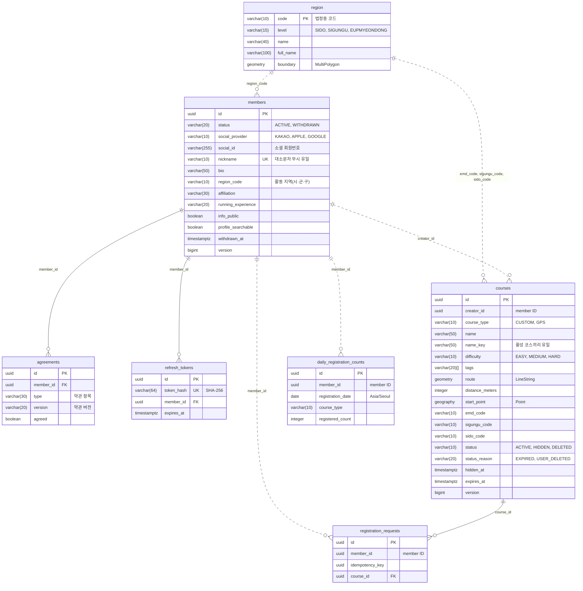

# 와다닥 DB 구조

지금 구현된 DB를 정리한 문서다. 기준은 마이그레이션 파일(`BackEnd/src/main/resources/db/migration/`)이고, 이 문서는 그 결과를 설명한다.

> **마이그레이션을 추가하는 PR에서 이 문서도 같이 고친다.** ERD, 스키마 목록, 테이블 설명을 마이그레이션 결과와 맞춘다([개발 정책 v3](개발%20정책%20v3.md) 6.5·10.5).

## 1. 개요

- PostgreSQL 17 + PostGIS 3.5. 로컬은 `BackEnd/compose.yaml`로 띄운다(포트 5433).
- 모듈마다 스키마 하나를 쓴다. 다른 모듈의 스키마는 조회·JOIN·FK 모두 하지 않는다(개발 정책 2장·6.1).

| 스키마 | 모듈 | 테이블 |
| --- | --- | --- |
| `member` | member | `members`, `agreements`, `refresh_tokens` |
| `course` | course | `courses`, `daily_registration_counts`, `registration_requests` |
| `common` | common | `region`, `event_publication`, `shedlock`, `flyway_schema_history` |

run, ranking, review, notification 스키마는 아직 없다. 해당 모듈을 구현할 때 이 문서에 추가한다.

### 공통 규칙 (개발 정책 6장)

- **PK**: 애플리케이션이 만든 UUID v7(`UuidV7.create()`). 예외는 `region`(법정동 코드), `shedlock`(작업 이름), `event_publication`(Modulith가 만듦), `flyway_schema_history`(Flyway가 관리)다.
- **시각**: `TIMESTAMPTZ`에 UTC로 저장한다. 엔티티 테이블은 모두 `created_at`·`updated_at`을 가진다(`BaseEntity`).
- **enum**: Java enum 이름을 `VARCHAR`로 저장하고 `CHECK`로 값을 제한한다.
- **낙관적 락**: 상태 변경 이벤트를 발행하는 테이블(`members`, `courses`)은 `version` 컬럼을 가진다.
- **FK**: 같은 스키마 안에서만 건다. 다른 모듈 ID는 값만 저장하고 인덱스를 만든다.
- **공간**: SRID 4326. 반경 검색은 `geography`, 경로 계산은 `geometry`(개발 정책 6.4).

## 2. ERD

- 실선: 같은 스키마 안의 FK
- 점선: 다른 모듈(스키마)의 ID를 값으로만 저장한 참조. FK 없음
- 모든 엔티티 테이블에 있는 `created_at`·`updated_at`은 생략했다. `common`의 인프라 테이블(`event_publication`, `shedlock`, `flyway_schema_history`)은 다른 테이블과 관계가 없어 4장에서만 설명한다.

## 3. 테이블

표의 NULL 칸에 O가 있으면 NULL을 허용한다. 비어 있으면 `NOT NULL`이다.

### 3.1 member

#### `member.members` — 회원

| 컬럼 | 타입 | NULL | 설명 |
| --- | --- | --- | --- |
| `id` | `UUID` | | PK |
| `status` | `VARCHAR(20)` | | `ACTIVE`, `WITHDRAWN` |
| `social_provider` | `VARCHAR(10)` | | `KAKAO`, `APPLE`, `GOOGLE` |
| `social_id` | `VARCHAR(255)` | O | 소셜 회원번호. 카카오는 회원번호, Apple·Google은 ID 토큰의 `sub`. 탈퇴하면 비운다 |
| `nickname` | `VARCHAR(10)` | O | 2~10자 한글·영문·숫자. 탈퇴하면 비운다 |
| `bio` | `VARCHAR(50)` | O | 한 줄 소개 |
| `region_code` | `VARCHAR(10)` | | 활동 지역(시·군·구) 법정동 코드. `common.region` 값이지만 FK는 없다 |
| `affiliation` | `VARCHAR(30)` | O | 소속(학교·회사·크루) |
| `running_experience` | `VARCHAR(20)` | | `BEGINNER`, `MONTHS_6`, `YEAR_1`, `YEAR_3` |
| `info_public` | `BOOLEAN` | | 정보 공개. 기본 `true` |
| `profile_searchable` | `BOOLEAN` | | 프로필 검색 허용. 기본 `true` |
| `withdrawn_at` | `TIMESTAMPTZ` | O | 탈퇴 시각 |
| `version` | `BIGINT` | | 낙관적 락 |

- `members_social_uk`: `UNIQUE (social_provider, social_id)`. 로그인할 때 소셜 계정으로 회원을 찾는다.
- `members_nickname_uk`: `UNIQUE (lower(nickname))`. 대소문자만 다른 닉네임도 중복으로 본다.
- 탈퇴 처리와 공개·검색 설정을 바꾸는 기능은 아직 없다. 지금은 가입할 때의 기본값만 들어간다.

#### `member.agreements` — 약관 동의 이력

| 컬럼 | 타입 | NULL | 설명 |
| --- | --- | --- | --- |
| `id` | `UUID` | | PK |
| `member_id` | `UUID` | | FK → `members.id` |
| `type` | `VARCHAR(30)` | | `OVER_14`(만 14세 이상), `SERVICE_TERMS`(서비스 이용약관), `PRIVACY_POLICY`(개인정보 수집·이용), `LOCATION_TERMS`(위치기반서비스 이용약관), `PROFILE_INFO`(프로필 정보) |
| `version` | `VARCHAR(20)` | | 동의한 약관 버전. 현재 버전은 `AgreementType`에 있다 |
| `agreed` | `BOOLEAN` | | 동의 여부 |
| `created_at` | `TIMESTAMPTZ` | | 동의 시각 |

- 행을 쌓기만 하고 고치지 않는다. 회원·항목별 현재 상태는 그 회원·항목의 마지막 행이다.
- 가입하면 5개 항목이 모두 현재 버전, `agreed = true`로 한 줄씩 생긴다. 모두 필수 항목이다.
- 약관 내용을 바꾸면 `AgreementType`의 버전을 올린다.
- `agreements_member_id_idx`: `(member_id)`

#### `member.refresh_tokens` — 리프레시 토큰

| 컬럼 | 타입 | NULL | 설명 |
| --- | --- | --- | --- |
| `id` | `UUID` | | PK |
| `token_hash` | `VARCHAR(64)` | | 토큰 원문의 SHA-256(hex). 원문은 저장하지 않는다 |
| `member_id` | `UUID` | | FK → `members.id` |
| `expires_at` | `TIMESTAMPTZ` | | 발급 후 7일 |

- `refresh_tokens_uk`: `UNIQUE (token_hash)`. 갱신·로그아웃 때 해시로 찾는다.
- `refresh_tokens_member_id_idx`: `(member_id)`
- 토큰은 한 번만 쓴다. 갱신하면 그 행을 지우고 새 행을 만들고, 로그아웃하면 지운다.
- 만료된 행을 지우는 배치는 아직 없다.

### 3.2 course

#### `course.courses` — 코스

| 컬럼 | 타입 | NULL | 설명 |
| --- | --- | --- | --- |
| `id` | `UUID` | | PK |
| `creator_id` | `UUID` | | 등록한 회원 ID(member 모듈, FK 없음) |
| `course_type` | `VARCHAR(10)` | | `CUSTOM`(지도에 입력점을 찍어 만든 코스), `GPS`(달린 기록으로 만든 코스) |
| `name` | `VARCHAR(50)` | | 표시용 이름. NFC 정규화, 앞뒤 공백 제거, 연속 공백은 한 칸 |
| `name_key` | `VARCHAR(50)` | | 중복 비교용 이름. NFC 정규화, 공백 전부 제거, 소문자. `한강 러닝`과 `한강러닝`은 같은 키 |
| `difficulty` | `VARCHAR(10)` | | `EASY`, `MEDIUM`, `HARD` |
| `tags` | `VARCHAR(20)[]` | | 코스 특징. 기본 `{}`. `FLAT`, `UPHILL`, `SHADE`, `RIVERSIDE`, `NIGHT_LIGHT`, `RESTROOM`, `CONVENIENCE_STORE`, `TRACK` |
| `route` | `geometry(LineString, 4326)` | | 기준 경로. 좌표 순서가 코스 방향이다(첫 점 출발, 마지막 점 도착) |
| `distance_meters` | `INTEGER` | | 경로 길이(m). 0보다 크다 |
| `start_point` | `geography(Point, 4326)` | | 출발점(`route`의 첫 점). 반경 검색용 |
| `emd_code` | `VARCHAR(10)` | | 출발점의 읍·면·동 법정동 코드 |
| `sigungu_code` | `VARCHAR(10)` | | 출발점의 시·군·구 코드 |
| `sido_code` | `VARCHAR(10)` | | 출발점의 시·도 코드 |
| `status` | `VARCHAR(10)` | | `ACTIVE` → `HIDDEN` → `DELETED`. 한 방향으로만 바뀐다 |
| `status_reason` | `VARCHAR(20)` | O | `EXPIRED`, `USER_DELETED` |
| `hidden_at` | `TIMESTAMPTZ` | O | 숨긴 시각 |
| `expires_at` | `TIMESTAMPTZ` | | 만료 시각. 등록일 포함 30일째 23:59:59(Asia/Seoul) |
| `version` | `BIGINT` | | 낙관적 락 |

- `courses_status_reason_ck`: `ACTIVE`면 `status_reason`·`hidden_at`이 모두 NULL이고, 그 밖의 상태면 둘 다 값이 있다.
- 지역 코드 3개는 시·도, 시·군·구 단위로 집계할 때 `common.region`을 JOIN하지 않으려고 모두 저장한다.
- 인덱스. `creator_id`를 빼면 모두 활성 코스만 대상으로 하는 부분 인덱스다(개발 정책 6.2).

| 인덱스 | 대상 | 조건 | 용도 |
| --- | --- | --- | --- |
| `courses_creator_id_idx` | `creator_id` | | 회원이 등록한 코스 |
| `courses_name_key_uk` | `name_key` (UNIQUE) | `ACTIVE` | 이름 중복 검사 |
| `courses_start_point_gix` | `start_point` (GiST) | `ACTIVE` | 반경 검색 |
| `courses_route_gix` | `route` (GiST) | `ACTIVE` | 유사 코스 후보 찾기 |
| `courses_tags_gin` | `tags` (GIN) | `ACTIVE` | 태그를 모두 가진 코스 조회 |
| `courses_emd_code_idx`, `courses_sigungu_code_idx`, `courses_sido_code_idx` | 지역 코드 | `ACTIVE` | 지역별 조회 |
| `courses_expires_at_idx` | `expires_at` | `ACTIVE` | 만료 배치 |
| `courses_hidden_at_idx` | `hidden_at` | `HIDDEN` | 숨긴 지 24시간 지난 코스 삭제 배치 |

- 지금은 사용자 지정(`CUSTOM`) 코스 등록만 행을 만든다. GPS 코스 등록과 숨김·삭제·만료 배치는 아직 없다.

#### `course.daily_registration_counts` — 일일 등록 수

| 컬럼 | 타입 | NULL | 설명 |
| --- | --- | --- | --- |
| `id` | `UUID` | | PK |
| `member_id` | `UUID` | | 회원 ID(member 모듈, FK 없음) |
| `registration_date` | `DATE` | | 등록 날짜(Asia/Seoul) |
| `course_type` | `VARCHAR(10)` | | `CUSTOM`, `GPS` |
| `registered_count` | `INTEGER` | | 그날 성공한 등록 수. 0 이상 |

- `daily_registration_counts_uk`: `UNIQUE (member_id, registration_date, course_type)`
- 하루 한도는 `CUSTOM` 1개, `GPS` 3개다. 성공한 등록만 센다.
- 그날 첫 등록이면 0건 행을 `INSERT … ON CONFLICT DO NOTHING`으로 만들고, 행을 잠근 뒤 1을 더한다. 같은 회원의 동시 등록이 함께 한도를 넘지 않는다.

#### `course.registration_requests` — 등록 멱등 키

| 컬럼 | 타입 | NULL | 설명 |
| --- | --- | --- | --- |
| `id` | `UUID` | | PK |
| `member_id` | `UUID` | | 회원 ID(member 모듈, FK 없음) |
| `idempotency_key` | `UUID` | | 앱이 등록 시도마다 만드는 키(`Idempotency-Key` 헤더) |
| `course_id` | `UUID` | | FK → `courses.id`. 그 키로 만든 코스 |

- `registration_requests_uk`: `UNIQUE (member_id, idempotency_key)`. 같은 키로 다시 요청하면 새로 만들지 않고 이 코스를 돌려준다.
- `registration_requests_created_at_idx`: `(created_at)`. 24시간 지난 행을 지우는 데 쓴다.
- 24시간 지난 행을 지우는 배치는 아직 없다.

### 3.3 common

#### `common.region` — 법정구역

읽기 전용 참조 데이터다. 시드 마이그레이션이 데이터를 넣는다. 시드 파일은 `BackEnd/scripts/region/build-seed.sh`로 만들고 직접 고치지 않는다.

| 컬럼 | 타입 | NULL | 설명 |
| --- | --- | --- | --- |
| `code` | `VARCHAR(10)` | | PK. 법정동 코드 10자리. 시·도는 앞 2자리, 시·군·구는 앞 5자리만 쓰고 나머지를 0으로 채운다 |
| `level` | `VARCHAR(15)` | | `SIDO`, `SIGUNGU`, `EUPMYEONDONG` |
| `name` | `VARCHAR(40)` | | 구역 이름. 예: `탕정면` |
| `full_name` | `VARCHAR(100)` | | 상위 구역을 붙인 이름. 예: `충청남도 아산시 탕정면` |
| `boundary` | `geometry(MultiPolygon, 4326)` | O | 경계. 읍·면·동만 가진다 |

- `region_boundary_gix`: `boundary` GiST. 좌표가 속한 읍·면·동을 찾는다(`RegionResolver`). 상위 구역은 코드 앞자리로 정한다.
- 다른 모듈은 코드 값만 저장하고 FK를 걸지 않는다.

#### `common.event_publication` — 이벤트 아웃박스

Spring Modulith가 관리한다. 이벤트를 발행하면 리스너마다 한 행이 생기고, 리스너가 처리를 마치면 지운다(`completion-mode: delete`).

- 주요 컬럼: `listener_id`, `event_type`, `serialized_event`, `publication_date`, `completion_date`, `status`, `completion_attempts`
- 남아 있는 행은 처리되지 않은 이벤트다. 앱을 다시 시작하면 다시 발행하고, `EventMonitor`·`EventRetryScheduler`가 1분마다 확인한다(개발 정책 5.5).

#### `common.shedlock` — 스케줄 작업 잠금

여러 인스턴스 중 한 곳에서만 스케줄 작업을 실행하게 한다(개발 정책 8.1). 행 하나가 작업 하나다(`common.event-monitor`, `common.event-retry`). 시각은 DB 시각(`TIMESTAMP`)을 쓴다.

#### `common.flyway_schema_history` — 마이그레이션 이력

Flyway가 관리한다. 모든 모듈의 마이그레이션 이력을 여기 한 곳에 둔다(개발 정책 6.5).
